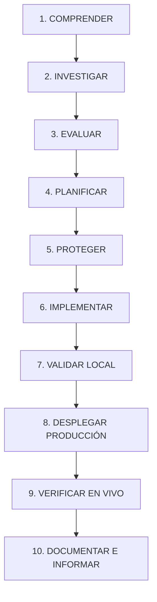

# SKILL 11 — PROFESSIONAL ENGINEERING WORKFLOW

## Objetivo
Establecer el procedimiento metódico, profesional y reproducible que el agente y cualquier desarrollador deben seguir rigurosamente en absolutamente todas las tareas, correcciones o mejoras en el sistema.

---

## Procedimiento Obligatorio de 10 Pasos

### PASO 1 — COMPRENDER
- Leer detenidamente la solicitud del usuario.
- Identificar el requerimiento de negocio y su objetivo operativo.
- No asumir intenciones no declaradas; si hay ambigüedad crítica, plantear opciones claras.

### PASO 2 — INVESTIGAR
- Inspeccionar el código real en `src/`, esquemas en `supabase/` y pruebas en `tests/`.
- Consultar `MEMORY.md`, `AGENTS.md` y las Skills relevantes.
- Determinar cómo funciona la característica actualmente antes de tocar una sola línea.

### PASO 3 — EVALUAR
- Clasificar el riesgo del cambio según la Política de Cambios Seguros (Bajo, Medio, Alto, Crítico).
- Evaluar dependencias directas e indirectas y posibles efectos secundarios.

### PASO 4 — PLANIFICAR
- Diseñar la solución técnica más segura, minimalista y mantenible.
- Priorizar la alternativa con menor cantidad de código modificado y menor riesgo de regresión.

### PASO 5 — PROTEGER
- Diseñar de antemano las pruebas unitarias o de integración que certificarán el cambio.
- Si se trata de un bug, reproducirlo primero con una prueba que falle.
- Establecer mecanismos de reversión (backup o commit limpio) antes de cambios de riesgo.

### PASO 6 — IMPLEMENTAR
- Realizar modificaciones quirúrgicas y ordenadas.
- Mantener tipado estricto en TypeScript sin utilizar `any`.
- Respetar la convención arquitectónica existente.

### PASO 7 — VALIDAR LOCALMENTE
- Ejecutar la prueba específica creada o modificada (`node tests/...`).
- Ejecutar la suite completa de pruebas de regresión local (100% en verde).
- Ejecutar verificación estática: `npx tsc --noEmit` y `npm run lint` (0 errores).
- Ejecutar compilación de producción: `npm run build` (100% páginas limpias).

### PASO 8 — DESPLEGAR A PRODUCCIÓN (OBLIGATORIO)
- Realizar commit limpio y descriptivo en Git.
- Enviar de inmediato los cambios a la rama `main` en GitHub (`git push origin main`).
- Activar y monitorizar el despliegue automático en Vercel.

### PASO 9 — VERIFICAR EN PRODUCCIÓN EN VIVO (OBLIGATORIO)
- Comprobar que la URL canónica responda con HTTP 200: `https://gestion-almuerzos-six.vercel.app`.
- Verificar directamente que la pantalla o funcionalidad modificada (ej. `/fiado`, `/despacho`, `/cocina`) refleje los cambios en el bundle productivo.
- Descartar excepciones de hidratación, errores 500 o fallos de red en vivo.

### PASO 10 — DOCUMENTAR E INFORMAR
- Actualizar `MEMORY.md` registrando la decisión técnica o de negocio confirmada.
- Actualizar la documentación técnica o tests cuando corresponda.
- Entregar un resumen claro, estructurado y transparente al usuario:
  - Qué cambió.
  - Resultados exactos de las pruebas locales.
  - Confirmación del commit y del despliegue en producción.
  - Comprobación y estado verificado en vivo.
